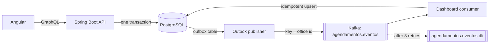

# Agendamento de Atendimentos

**[Live demo](https://jvcamargo10.github.io/agendamento-atendimentos/)** · [Leia em português](README.pt-BR.md)

Appointment booking for city-hall services (ID cards, social programs, permits): citizens pick an office, a
service and a time; front-desk staff record attendance; managers see a daily dashboard fed by events.

> The GitHub Pages demo runs in the browser with fictitious data. The real back-end lives in this repository and
> CI tests it against real PostgreSQL and Kafka, then deploys it to a Kubernetes cluster.

## Stack

| Layer | Technology |
|---|---|
| API | Java 21, Spring Boot 3.5, Spring for GraphQL, virtual threads |
| Database | PostgreSQL 16, Flyway migrations, `JdbcClient` with explicit SQL |
| Messaging | Apache Kafka (spring-kafka), transactional outbox, dead-letter topic |
| Deployment | Docker (layered jar, non-root), Helm chart, Kubernetes (HPA, PDB, probes) |
| Observability | Spring Boot Actuator, Micrometer/Prometheus, structured JSON logs (ECS) |
| Tests | JUnit 5, Testcontainers (PostgreSQL + Kafka), GraphQL tester, Awaitility |
| Front-end | Angular 21 (standalone components, signals, zoneless), Jest |
| CI/CD | GitHub Actions: tests, `helm lint`, deploy to a **kind** cluster with smoke test, Pages deploy |

## Architecture



## Technical decisions

**Capacity is enforced by one atomic statement.** Booking runs
`UPDATE vagas SET ocupadas = ocupadas + 1 WHERE id = ? AND ocupadas < capacidade RETURNING ...`. PostgreSQL
serializes updates on the same row, so with 10 simultaneous requests for a 2-seat slot exactly 2 succeed, and no
read-then-write race is possible. A `CHECK (ocupadas BETWEEN 0 AND capacidade)` guards the invariant. A test
fires 10 parallel bookings and asserts this.

**"One active booking per citizen per day" is a partial unique index**
(`UNIQUE (cpf_hash, dia) WHERE status = 'AGENDADO'`). Cancelled bookings don't count, and the rule holds even under
concurrency. The service checks first only to return a friendly message.

**The CPF (Brazilian tax ID) is never stored.** The database keeps an HMAC-SHA256 of it (with a secret key, so it
can't be brute-forced from the ~10⁹ possible values) plus the last 3 digits for the front desk to check the
document.

**Transactional outbox.** Writing to the database and to Kafka are two systems; doing both directly can lose
events or publish events for rolled-back transactions. Events are written to an `outbox` table in the same
transaction as the change, and a scheduled publisher sends them to Kafka (`acks=all`, idempotent producer),
marking them only after the broker confirms. Pending rows are read with `FOR UPDATE SKIP LOCKED`, so several
replicas can publish in parallel. The `outbox.pendentes` gauge shows the backlog.

**Idempotent consumer and dead-letter topic.** Delivery is at least once, so the dashboard consumer records the
event id in `eventos_processados` in the same transaction as the counter update; a redelivered event is skipped
(tested by re-publishing an event). A message that keeps failing is retried 3 times and then sent to
`agendamentos.eventos.dlt`, so it doesn't block the partition. Events are keyed by office id, so each office's
events stay in order.

**GraphQL without N+1.** Nested fields (`Agendamento.unidade`, `Unidade.servicos`) use `@BatchMapping`: a list of
50 bookings triggers one query for offices, not 50.

**Time is injected.** All time rules (cancellation up to 2 h before, past slots) use an injected `Clock`. Tests
freeze it on a known Monday at 07:00, so results don't depend on when CI runs.

**Kubernetes.** The Helm chart has startup, liveness and readiness probes (Actuator health groups), an HPA, a
PodDisruptionBudget, a rolling update with `maxUnavailable: 0`, a non-root container with all capabilities
dropped, and a config checksum annotation that restarts pods when the ConfigMap changes. CI creates a kind cluster,
deploys PostgreSQL, Kafka and the chart with 2 replicas, then runs a GraphQL smoke test through the Service.

## Running locally

```bash
docker compose up --build
# GraphiQL:  http://localhost:8080/graphiql
# Metrics:   http://localhost:8080/actuator/prometheus
# Kafka UI:  http://localhost:8081

cd frontend && npm install && npm start   # http://localhost:4200, pointing to localhost:8080/graphql
```

Example query:

```graphql
{
  unidades { nome servicos { nome } }
  horariosDisponiveis(unidadeId: 1, servicoId: 1, dia: "2030-03-05") { vagaId inicio disponiveis }
}
```

Tests (need Docker for Testcontainers): `cd backend && mvn verify` · `cd frontend && npm test`

Deploying to a cluster:

```bash
kubectl create secret generic agendamento-segredos --from-literal=senha=... --from-literal=segredo-cpf=...
helm upgrade --install agendamento deploy/helm/agendamento --set image.repository=<registry>/agendamento --set image.tag=<sha>
```

## Project layout

```
backend/
  src/main/java/.../agenda      booking service, SQL repository, slot generator
  src/main/java/.../eventos     outbox publisher and Kafka dashboard consumer
  src/main/java/.../graphql     GraphQL controller and error mapping
  src/main/resources/db         Flyway migrations
  src/main/resources/graphql    GraphQL schema
deploy/helm/agendamento         Helm chart
deploy/kind                     dependencies and smoke test used by CI
frontend/                       Angular app; src/app/api/demo-api.ts simulates the API for the Pages demo
```
