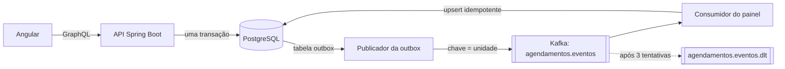

# Agendamento de Atendimentos

**[Demo ao vivo](https://jvcamargo10.github.io/agendamento-atendimentos/)** · [Read in English](README.md)

Agendamento de serviços de prefeitura (RG, CadÚnico, alvarás): o cidadão escolhe a unidade, o serviço e o horário;
o atendente registra o comparecimento no balcão; a gestão acompanha um painel diário alimentado por eventos.

> A demo no GitHub Pages roda no navegador, com dados fictícios. O back-end real está neste repositório; o CI o
> testa contra PostgreSQL e Kafka reais e depois o implanta num cluster Kubernetes.

## Stack

| Camada | Tecnologia |
|---|---|
| API | Java 21, Spring Boot 3.5, Spring for GraphQL, threads virtuais |
| Banco | PostgreSQL 16, migrações Flyway, `JdbcClient` com SQL explícito |
| Mensageria | Apache Kafka (spring-kafka), outbox transacional, tópico de mensagens mortas |
| Implantação | Docker (jar em camadas, usuário não root), Helm chart, Kubernetes (HPA, PDB, probes) |
| Observabilidade | Spring Boot Actuator, Micrometer/Prometheus, logs estruturados em JSON (ECS) |
| Testes | JUnit 5, Testcontainers (PostgreSQL + Kafka), GraphQL tester, Awaitility |
| Front-end | Angular 21 (componentes standalone, signals, zoneless), Jest |
| CI/CD | GitHub Actions: testes, `helm lint`, implantação num cluster **kind** com teste de fumaça, deploy no Pages |

## Arquitetura



## Decisões técnicas

**A lotação é garantida por uma instrução atômica.** O agendamento executa
`UPDATE vagas SET ocupadas = ocupadas + 1 WHERE id = ? AND ocupadas < capacidade RETURNING ...`. O PostgreSQL
serializa os UPDATEs na mesma linha: com 10 pedidos simultâneos para um horário de 2 vagas, exatamente 2 passam, e
não existe a corrida de "ler e depois escrever". Um `CHECK (ocupadas BETWEEN 0 AND capacidade)` protege a regra.
Um teste dispara 10 agendamentos em paralelo e confere isso.

**"Um agendamento ativo por cidadão por dia" é um índice único parcial**
(`UNIQUE (cpf_hash, dia) WHERE status = 'AGENDADO'`). Cancelados não contam, e a regra vale mesmo com
concorrência. O serviço consulta antes só para devolver uma mensagem amigável.

**O CPF nunca é gravado.** O banco guarda um HMAC-SHA256 dele (com chave secreta, para não ser revertido por força
bruta entre os ~10⁹ valores possíveis) e os 3 últimos dígitos, para o atendente conferir o documento.

**Outbox transacional.** Gravar no banco e no Kafka são dois sistemas; fazer os dois direto pode perder eventos ou
publicar eventos de transações desfeitas. O evento é gravado na tabela `outbox` na mesma transação da mudança, e
um publicador agendado envia ao Kafka (`acks=all`, produtor idempotente), marcando como publicado só depois da
confirmação do broker. Os pendentes são lidos com `FOR UPDATE SKIP LOCKED`, então várias réplicas publicam em
paralelo. A métrica `outbox.pendentes` mostra o acúmulo.

**Consumidor idempotente e tópico de mensagens mortas.** A entrega é "pelo menos uma vez", então o consumidor do
painel registra o id do evento em `eventos_processados` na mesma transação da atualização do contador; um evento
reentregue é ignorado (o teste republica um evento para provar). Uma mensagem que continua falhando é tentada 3
vezes e vai para `agendamentos.eventos.dlt`, sem travar a partição. A chave é o id da unidade, então os eventos de
cada unidade ficam em ordem.

**GraphQL sem N+1.** Campos aninhados (`Agendamento.unidade`, `Unidade.servicos`) usam `@BatchMapping`: uma lista
de 50 agendamentos faz 1 consulta de unidades, e não 50.

**O tempo é injetado.** Todas as regras de horário (cancelamento até 2 h antes, horários passados) usam um `Clock`
injetado. Os testes congelam o relógio numa segunda-feira às 07h, então o resultado não depende de quando o CI roda.

**Kubernetes.** O Helm chart tem probes de startup, liveness e readiness (grupos de health do Actuator), HPA,
PodDisruptionBudget, rolling update com `maxUnavailable: 0`, contêiner não root sem capabilities e uma anotação de
checksum que reinicia os pods quando o ConfigMap muda. O CI cria um cluster kind, sobe PostgreSQL, Kafka e o chart
com 2 réplicas, e faz um teste de fumaça GraphQL pelo Service.

## Rodando localmente

```bash
docker compose up --build
# GraphiQL:  http://localhost:8080/graphiql
# Métricas:  http://localhost:8080/actuator/prometheus
# Kafka UI:  http://localhost:8081

cd frontend && npm install && npm start   # http://localhost:4200, apontando para localhost:8080/graphql
```

Exemplo de consulta:

```graphql
{
  unidades { nome servicos { nome } }
  horariosDisponiveis(unidadeId: 1, servicoId: 1, dia: "2030-03-05") { vagaId inicio disponiveis }
}
```

Testes (precisam de Docker por causa do Testcontainers): `cd backend && mvn verify` · `cd frontend && npm test`

Implantação num cluster:

```bash
kubectl create secret generic agendamento-segredos --from-literal=senha=... --from-literal=segredo-cpf=...
helm upgrade --install agendamento deploy/helm/agendamento --set image.repository=<registro>/agendamento --set image.tag=<sha>
```

## Estrutura

```
backend/
  src/main/java/.../agenda      serviço de agendamento, repositório SQL, gerador de horários
  src/main/java/.../eventos     publicador da outbox e consumidor Kafka do painel
  src/main/java/.../graphql     controller GraphQL e tratamento de erros
  src/main/resources/db         migrações Flyway
  src/main/resources/graphql    esquema GraphQL
deploy/helm/agendamento         Helm chart
deploy/kind                     dependências e teste de fumaça usados no CI
frontend/                       app Angular; src/app/api/demo-api.ts simula a API para a demo no Pages
```
